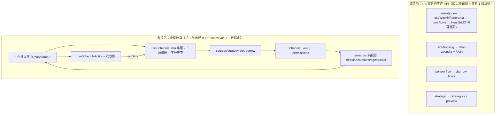
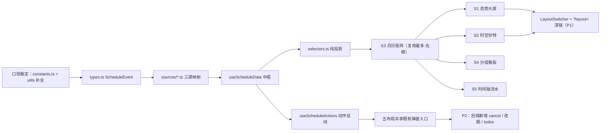
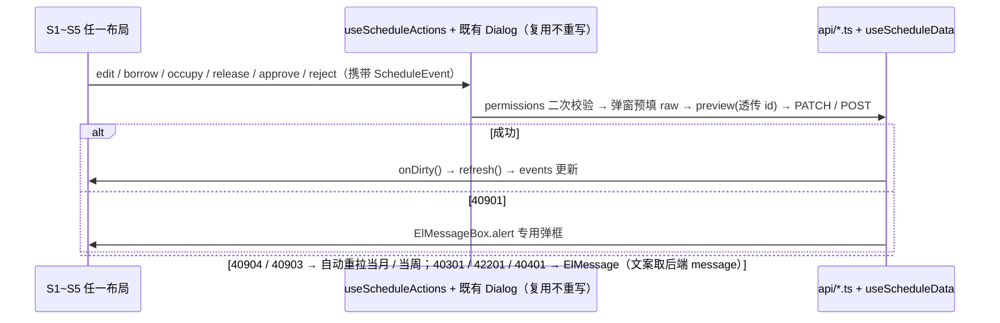

# 调度全景展示 系统架构设计（增量）

| 项 | 内容 |
|---|---|
| 日期 / 撰写 / 状态 | 2026-10-12 / 高见远（架构师） / 待评审 |
| 上游输入 | PRD `docs/superpowers/specs/2026-10-12-scheduling-panorama-prd.md`（许清楚）；配套 checkbox 实施计划 `plans/2026-10-12-scheduling-panorama-plan.md` |
| 覆盖范围 | 在同一后端 + 同一套 API 之上，建设 **5 个相互独立、功能等价** 的调度全景页面 |
| 硬性红线 | 不引入重型表格库；P0/P1 不新增后端接口；不臆造现有不存在的组件/接口；新增资产一律标注「新增」 |

> **编号映射**：PRD §4 列了 L1~L5（含「周×时刻矩阵」L1），本文以任务书指定 **S1~S5** 为准。对应：S3≈L2、S2≈L3、S4≈L4、S5≈L5；**L1（现状 `/weekly-new/index`）不在本次新建范围**，处置见 §5.3 与 §6-Q9。
## §1 项目现状分析（技术视角）
### 1.1 分层现状表
| 层 | 职责 | 关键文件 | 现状评价 | 可优化点 |
|---|---|---|---|---|
| 路由 / 页面层 | 菜单注册（`meta.roles`）、页面装配 | `router/asyncRoutes.ts`（静态注册，`initRouter()` 本地短路）、`views/{weekly-new,slot-booking,borrow-flow,strategy}/index.vue` | 良：静态可读，角色常量收敛为 `ALL_ROLES`/`PM_ROLE`/`ADMIN_ROLE` | **四场景分散在 4 个页面**，用户需跨页跳转才有完整视图；无统一父级菜单 |
| 数据获取编排层 | 并发编排、过期响应丢弃、缓存失效、点击分发 | `composables/useWeeklyPanorama.ts`、`useStrategyPreview.ts`、`useBranchColors.ts` | **中**：已抽出中间结构（`weekDays`/`timeRows`/`TaskClickResult`），但强耦合「周 × 时刻矩阵」假设 | ①`timeRows` 只渲染有任务的时间点（**非线性铺满**），甘特/日历无法复用；②只编排 `/weekly`，不含抢占与借用两条源；③**无单测**（`composables/__tests__/` 仅 4 个 spec） |
| 纯函数层 | 权限、过期、周序、月历、轮询退避、剪贴板 | `utils/{business,week,slotCalendar,polling,appUrl,clipboard}.ts` | **优**：均已单测锁定 | `business.ts` 缺登录态异常分支覆盖；缺「事件 → 权限包」组合判定 |
| 业务 API 层 | 统一 `http.ts`（解包 data / reject `BizError` / `silent`）、类型契约 | `api/{weekly,strategy,plan,borrowFlow,slotBooking}.ts` + `api/types.ts` | **优**：13 模块类型齐备；`/plan` 已返回 `timeline`（build/smoke/analysis/push 绝对区间 + `conflict`） | `/api/plan` 为**单日**入参（`date`），范围画布须 N 次调用，需设计懒加载策略 |
| 后端服务层 | 校验 + `transaction.atomic`、周期唯一约束、条件 UPDATE 抢占 | `services/{strategies,timeline,slot_booking,borrow_flow}.py`、`views/*.py` | **优**：279 例测试全绿；写路径统一、错误码语义固定 | 两套调度体系**无外键关联**，无法后端双向互斥；缺待办聚合（PRD P2-R3） |
| 数据模型层 | 领域模型 + DB 部分唯一约束兜底并发 | `models/*.py`；`uniq_slot_booking_active`、`uniq_pending_borrow_flow` | **优**：并发由 DB 兜底，不依赖应用层锁 | P0/P1 不动模型；任何模型改动须 `makemigrations` 并提交迁移（AGENTS.md 纪律） |

### 1.2 核心矛盾（架构必须正面回答的 6 条）
1. **两套调度体系无外键关联**：策略时间线（每日循环，由 `build_start_time` + `RuntimeConfig` 分钟推导 4 阶段）与时段抢占（`SlotTemplate` 固定器 + `SlotBooking` 快照）是**两条独立资源池**，服务端互不感知；合到一张画布只能由前端做**时间轴投影**。
2. **四场景分散在 4 个页面**：改（`/strategy` + 系统管理 Tab）、抢（`/slot-booking` + `/slot-config`）、借用/借出（`/borrow-flow`）、纵览（`/weekly-new`）彼此割裂，跨源冲突无人负责提示。
3. **`useWeeklyPanorama` 强耦合「周 × 时刻矩阵」**：`weekDays` 固定 7 列、`timeRows` 由 `Set<time>` 聚合，输出是**矩阵专用**的；且 `timeRows` **非线性铺满**（无任务时段被省略），任何需要连续时间轴的布局都得先改造它。
4. **既有自绘展示组件不可跨页复用**：`HourGrid.vue` 硬编码 `grid-template-columns: 64px repeat(7,minmax(0,1fr))` 且 `min-width:760px`；`MonthGrid`/`SlotChip` 绑定 `CalendarDayCell` 形状。二者都是「特定结构 → 特定 DOM」，无法直接消费多源事件。
5. **缺失单测**：`useWeeklyPanorama`（无 spec）与 `SlotChip.vue`（无 spec）正处本次改动的正中心，改前必须先补基线测试，否则无法证明「改造后行为不变」。
6. **文案唯一来源纪律已被侵蚀**：抢占状态中文文案在 `DayDetailDialog.vue:32`、`MyBookingsDrawer.vue:126-128`、`slot-booking/index.vue:50` 以三元表达式**硬编码三份**；`views/constants.ts` 只有 `borrowStatusMap`，**没有 `slotStatusMap`**。多布局并行会把该缺陷放大 5 倍。

### 1.3 改造前 vs 改造后调用链

> **改造前**：4 个页面各自 `import api` → 各自拼数据 → 各自绑定特定 DOM，新增一种布局 = 复制一份编排逻辑。**改造后**：只有中枢直连 API，5 个路由仅消费 `ScheduleEvent[]` + `selectors`；**加第 6 种布局不碰后端、不碰其余 5 个布局**。

### 1.4 数据口径统一清单（5 布局共用，任一处不得自行换算）
| 口径项 | 统一约定 | 唯一来源 / 处置 |
|---|---|---|
| 日期 | `YYYY-MM-DD` | 深链 `?month=` 与 `week_start=` 均用此格式 |
| 时刻（策略 / 时段起止） | `HH:mm`（`SlotTemplateItem` 为 `HH:MM`，入 `dayjs` 前归一化） | `utils/business.ts::formatTime` |
| 后端绝对时刻序列化 | `%Y-%m-%dT%H:%M:%S`，Asia/Shanghai，`USE_TZ=True` | AGENTS.md；前端一律走 `parseTime()` |
| weekdays | **isoweekday 1-7（1=周一…7=周日）**，空 = 每天；**禁用 0 基口径** | AGENTS.md 已硬化（曾有周日模板 bug） |
| 过期判定 | **惰性**，`isPastSlot(date, time, now)` 按格子判定；**无 `expired` 枚举**、不落库 | `utils/business.ts`；历史格只读、未来格可操作（Q8 建议） |
| 抢占窗口 | `today ≤ date ≤ today + horizon_days` | 由 `/slot-calendar` 返回，**前端不硬编码 60** |
| 并发唯一 | `(date, template)` 唯一 reserved、`(strategy, borrower)` 唯一 pending | DB 条件唯一约束兜底 → 前端处理 40904 / 40903 |
| 错误码 | 仅 `40100/40101/40301/40401/42201/40901/40902/40903/40904/42901`；HTTP status 由 `errors.py:29-41` 映射 | 新增场景**不得新造码** |
| 状态中文文案 | 待审批 / 已通过 / 已驳回 / 已抢占 / 已释放 / 草稿 / 已发布 / 正常 / 同步 | `views/constants.ts`（`borrowStatusMap` 已有；**新增 `slotStatusMap`**） |
| 可见性口径 | 借用流：admin 全量；pm = `Q(borrower=self)` ∪ `Q(strategy__branch__version__pm_user=self)`；其余仅自己发起 | 后端 `views/borrow_flow.py`；前端只读不重算 |
| 复制文案 XSS | VNode 文本渲染，**禁用 `dangerouslyUseHTMLString`** | PRD 场景 D 边界②；`utils/clipboard.ts` |
| 适配口径 | **仅桌面端（PC only）**：目标环境 = 桌面浏览器，建议最小支持 **1280×720**；**不做移动端 / 平板 / 触屏适配**，不设响应式断点；小窗口允许横向滚动 + 容器 `min-width`，内容不重排；**保留 PC 键盘可达性** | 唯一出处见 **§4.1 执行约束**（适配口径条目） |
| 配色口径 | 5 布局共用**唯一配色映射表**：业务色板外一律用 `.biz-*` 类 + `--el-*` 语义变量；分支色走 `BRANCH_PALETTE`、阶段色走 `STAGE_COLORS`、时段色取服务端 `SlotTemplate.color`、状态徽标走 `TagMeta.type`；**禁止页面硬编码 hex** | 唯一出处见 **§4.1**（含用户裁定口径与反例说明） |

## §2 优化目标与任务分工
### 2.1 可度量优化目标
| # | 现状 → 目标 | 度量方式 |
|---|---|---|
| G1 | 四场景分散 4 页面（平均跨 3 次跳转完成「发现冲突 → 抢占 → 借用 → 审批」）→ 单页内闭环 | 四场景在**任一布局**内完成，跳转次数 = 0；P0-R1~R6 全绿 |
| G2 | 新增一种调度视图需复制整套数据编排 → 新增只需写渲染层 | **新增第 6 布局改动文件 ≤ 3**（1 个 `layouts/sN/index.vue` + 1 行路由 + 1 个 spec），且**后端改动 = 0、其余布局改动 = 0** |
| G3 | `useWeeklyPanorama` 与 `SlotChip` 无单测 → 中枢 + 纯投影全覆盖 | 前端 spec ≥ 104 → **≥ 112**（新增 ≥ 8 个 spec 文件）；`npm run test`/`typecheck`/`build` 全绿 |
| G4 | 抢占状态文案 3 处硬编码 → 5 布局单点取用 | `grep -rn "已抢占\|已释放" views/` 命中**仅 1 处**（`views/constants.ts`） |
| G5 | 两套体系互不感知、跨源冲突无人提示 → 同画布叠加 + 视觉提示（不改后端互斥逻辑） | 5 布局均过 P1-R3：策略块与已抢占时段同时间轴、重合处有冲突标记；后端测试仍 ≥ 279 |

### 2.2 责任人与交付物表
| 模块 | 责任人 | 交付物（文件路径） | 验收标准 | 依赖项 | 优先级 |
|---|---|---|---|---|---|
| 前端展示层 · 数据展示适配 | 寇豆码（工程师） | `views/panorama/{types,useScheduleData,useScheduleActions,usePanoramaFilter,context,selectors}.ts`、`sources/*.ts`、`layouts/s1~s5/index.vue`、`shared/*`、`LayoutSwitcher.vue` | 5 路由功能等价；四场景在 5 布局均可完成；路由刷新保持 | §5 中枢与动作总线定型 | P0 |
| 前端基建 · 文案与纯函数 | 寇豆码（工程师） | `views/constants.ts`（**新增** `slotStatusMap`）、`utils/week.ts`（**新增** `buildDateRange`）、`store/constants.ts`（**新增** `panoramaLayoutKey`） | G4 命中唯一；纯函数 spec 全绿 | 口径裁定 | P0 |
| 后端服务层 | 寇豆码（工程师） | **P0/P1 零改动**；P2 才动 `views/borrow_flow.py`（cancel）、`views/slot_booking.py`（改期）、**新增** `views/panorama.py`（todos 聚合） | 错误码未新增；`{code,message,data}` 契约不变；迁移随模型改动提交 | Q4/Q5/Q6 决策 | P2 |
| 数据层 | 寇豆码（工程师） | P0/P1 **无 migration**；P2 若动模型须 `makemigrations build_protection_service` 并提交 | `makemigrations --check` 无告警；`migrate` 干净 | P2 立项 | P2 |
| 测试 | 严过关（QA） | 前端 `views/panorama/__tests__/*.spec.ts`（≥ 8 个）；后端全量回归 | `npm run test` ≥ 112 全绿；`python manage.py test build_protection_service` ≥ 279 全绿 | 中枢、selectors 定型 | P0 |
| 文档 / 口径裁定 | 高见远（架构师） | 本设计文档 + 配套 plan；§6 Q1~Q10 裁定记录 | PRD 与本文无口径冲突；5 布局术语一致 | PRD 评审结论 | P0 |
| 整体编排与验收 | 齐活林（主理人） | 阶段 Gate：P0 打底 → P1 铺开 → P2 增强；执行提交前测试门禁 | 每阶段测试全绿才允许提交（AGENTS.md 强制） | 全员 | P0 |
| 产品口径 | 许清楚（产品经理） | PRD 定稿；Q1~Q8 答复；S3/S4 信息密度与默认筛选口径确认 | 5 布局「谁在什么情况下用」文案可落地 | — | P0 |

### 2.3 模块依赖与实现顺序

> **实现顺序建议：先 S3（复用 `MonthGrid`/`SlotChip` 最多，最快端到端跑通），再 S1/S2，最后 S4/S5** —— 理由是 S3 能最早验证「中枢 → 选择器 → 既有组件改造」这条链路是否真的省事。

## §3 业务场景拆解（引用 PRD，不重写细节）
> 四场景的完整流程、Mermaid 状态图、角色矩阵、错误码表，**一律以 PRD 为唯一出处**：`.../2026-10-12-scheduling-panorama-prd.md` §3 A/B/C/D。**5 种布局共享本节全部内容，不做任何分支定义。**

| 场景 | 统一入口（5 布局共用） | 触发方式 | 状态流转 起点 → 终点 | 权限守卫（后端 / 前端） | 关键错误码 |
|---|---|---|---|---|---|
| **A 修改** | `StrategyEditDialog.vue`（复用） | 点未过期策略事件 → `kind:"edit"` | 只读 →（预览可冲突）→ **已保存** | `views/strategies.py::_check_pm_bound` / `canEditPanorama()` | 40901（专用弹框）、40902、42201、40301 |
| **B 借用** | `StrategyBorrowDialog.vue`（复用） | 无编辑权限者点事件 → `kind:"borrow"` | 无 → **待审批** → **已通过**（目标分支现新策略）/ **已驳回** | 任意登录用户可发起 / `getCurrentUser()` 判是否在位 | 40903、42201、40401、40301 |
| **C 抢占** | `BookingDialog` + `SlotDetailDialog` + `MyBookingsDrawer`（复用） | 点空闲 / 已占时段格 | 空闲 → **已抢占** → **已释放** → 空闲；过去日期 → **惰性置灰** | `services/slot_booking` 校验链 + `user == booking.user`（他人仅 admin）/ `isPastSlot` + 服务端 `is_mine` | 40904、42201、40301、40401 |
| **D 借出** | **新增** `BorrowApprovalDrawer.vue`（红点 + 抽屉） | 「待我审批」入口 / 借用事件卡上的审批按钮 | **待审批** → **已通过**（事务内建策略）/ **已驳回**（意见必填） | `views/borrow_flow.py::_can_approve` / `canApproveBorrowFlow(user,{source_version_id})` | 40301、40903、42201、40901/40902 |

**需求池落位**（详见 PRD §5）：P0 = R1~R6（本文 Phase 1）；P1 = R1~R5（切换器 / 统一筛选 / 跨源叠加 / 批量 / 无障碍）；P2 = R1~R5，**其中 R1/R2/R3 才是真正需要后端改造的三项**，其余为决策项。

## §4 五种布局方案（本文核心）
> 通用约定：5 方案均为**独立路由 + 独立 `.vue` 页面**，共享 `useScheduleData` 中枢、`useScheduleActions` 动作总线、`usePanoramaFilter` 筛选栏、`views/constants.ts` 文案与权限；**切换布局不换数据、不换动作语义**。
### 4.0 五布局共享的输入 / 动作契约

| 共享层 | 内容 | 唯一出处 |
|---|---|---|
| 共享输入 | `ScheduleEvent[]`（三源同构）+ `days` 日期轴 + `selectors` 纯投影 | `views/panorama/{types,useScheduleData,selectors}.ts`（**新增**） |
| 共享动作 | `edit`/`borrow`/`occupy`/`release`/`approve`/`reject` 六动作 + `copyText` | `views/panorama/useScheduleActions.ts`（**新增**） |
| 共享权限与文案 | `SchedulePermissions` 权限包；状态中文文案（待审批/已通过/已驳回/已抢占/已释放/正常/同步） | `utils/business.ts` + `views/constants.ts` |
| 共享筛选与刷新 | 时间范围 / 版本 / 分支 / 状态 / 仅看我的；成功后统一 `onDirty()` → `refresh()` | `usePanoramaFilter.ts`（**新增**）+ `utils/polling.ts` |
| 禁止事项 | 页面自造权限判断、自造状态中文文案、直接 `import` 业务 API、绕开动作总线 | AGENTS.md 已有纪律 + 本文 §5.3 |

### 4.1 视觉与配色规范（5 布局共用）

> **用户口径裁定**：「页面风格保持与系统一致，配色等保持与系统样式差不多的」——差异化仅限信息排布与交互，配色/圆角/间距/深浅色一律随系统全局；**反例**：`views/weekly-report/theme.scss` 的「子树局部覆盖 `--el-*`」深色科技风手法本次不采用。

**唯一配色映射表（5 布局逐项一致，禁止自造）**

| 用途 | 取色来源 | 具体值 / 变量 | 备注 |
|---|---|---|---|
| 页面容器 / 卡片 / 筛选栏 / 标题 / 辅助文字 / 统计卡 / 可点元素 | `src/style/business.scss` 既有类 | `.biz-page` / `.biz-card` / `.biz-filter-bar`（+`.biz-filter-left`）/ `.biz-card-head` / `.biz-card-title` / `.biz-sub` / `.biz-tip` / `.biz-stat-grid` / `.biz-clickable` | **不新建 scoped 主题、不复制改写**；统计卡一律 `.biz-stat-grid` |
| 分支色 | `composables/useBranchColors.ts` → `BRANCH_PALETTE` | 6 色：`#3b82f6`、`#8b5cf6`、`#f59e0b`、`#10b981`、`#ef4444`、`#06b6d4` | **同一 `branch_id` 在 5 布局内必须同色**；首位 `#3b82f6` 保留作 UI 主色（未知分支回退色），分支从第二位起按 `branch_id` 稳定取色 |
| 策略四阶段色 | `src/components/gantt/types.ts` → `STAGE_COLORS` | `build:#3b82f6`、`smoke:#8b5cf6`、`analysis:#f59e0b`、`push:#10b981` | 仅用于「按阶段展开区块」的布局（S2 主用、S5 次用）；**推送仍沿用既有「虚线描边」区分法**，不额外加新色 |
| 抢占时段色 | `SlotTemplateItem.color`（后端字段） | 默认 `#409eff`；预设 Element Plus 8 色板由 admin 在 `/slot-config` 配置 | 色值与 `enabled`/`color` 一样属**服务端下发**，前端原样使用、禁止覆盖 |
| 借用 / 审批等状态徽标色 | `views/constants.ts` 的 `TagMeta.type` | `success` / `danger` / `warning` / `info` / `primary` → `el-tag` 语义类型 | **不写死 hex**；冲突/告警复用同表语义色（`danger`/`warning`）与既有斜纹、闪烁表现，**不新增 keyframes**；新增状态文案走同一张映射表（含本次新增的 `slotStatusMap`） |
| 过期 / 禁用 / 「今天」高亮 | 沿用既有表现 | `isPastSlot = true` → **置灰 + 删除线**且不可交互；今日沿用 `HourGrid.vue` / `DayCell.vue` 现有 today 标记 | **无 `expired` 枚举**（惰性判定）；今日标记统一抽到 `shared/`，不得各自实现 |

**执行约束**
- 5 布局只允许在「网格结构、行列定义、区块顺序、交互手势」上差异化；**任何新色值、新主题作用域、新 CSS 变量均需架构师书面确认**。
- 页面内**禁止硬编码 hex**（色板常量文件除外）；验收命令：`grep -rn "#[0-9a-fA-F]\\{6\\}" views/panorama/`。
- 深浅色切换（`html.dark` / `data-theme`）下 5 布局均不得出现破面、对比度不足或不可读文本。
- **适配口径（PC only）**：目标环境 = 桌面浏览器，**建议最小支持 1280×720**；**不做移动端 / 平板 / 触屏适配**，不设响应式断点降级，也不做触屏热区放大一类约束；**小窗口只允许横向滚动**（容器 `min-width`，内容不重排，S2 甘特建议 ≥ 960px），此为**既定取舍而非缺陷**。
- **PC 键盘可达性继续有效**：`Tab` / `Enter` / `Space` 可完成主要操作、`:focus-visible` 焦点环可见、可点元素为 `<button>` + `aria-label`、状态不靠颜色单独表达。

### S1 调度大屏态势视图 — `/panorama/dashboard`
**1）定位**：给「值不值得点进去看」一个答案。**适用**：版本负责人每日晨会投屏、版本经理判断本周资源紧张度、值班人员快速发现异常。

**2）线框图**
```
┌─ 筛选栏 [日期范围][版本▾][分支▾][状态▾][仅看我的] ── ⟳ ── 布局▾ ─┐
│ ① KPI 卡：今日构建 12 │ 本周抢占 18/24 │ 待我审批 3 │ 冲突告警 2 │
│ ② 本周负载热力（时刻 × 周一~周日，色深=事件数，占位率 62%）        │
│   08:00 ▓▓ ▒▒ ▓▓ ▓▓ ░░ ░░ ░░   14:00 ▓▓ ▓▓ ▒▒ ▓▓ ░░ ░░ ░░         │
│   点格 → 下钻 S5 当日流水；点 KPI → 下钻 S3 / S4                    │
├──────────────────────────────┬────────────────────────────────────┤
│ ③ 异常告警 Top N              │ ④ 待办队列（待批借用3 / 我的抢占5） │
│  ⚠ 冲突：27A×分支B 14:00      │ ● 张三 借用 27A@10:00 [通过][驳回]  │
│  ⚠ 时段被占但策略仍在跑       │ ● 我的抢占 10-15 14:00 [释放][全选] │
└──────────────────────────────┴────────────────────────────────────┘
```
> **请求量与刷新**：首屏 `/weekly`(1) + `/slot-calendar`(1~2 个月视跨度) + `/borrow-flows?status=pending`(1) + `/plan?date=今日`(1，仅供冲突 KPI)；接 `polling.ts` 30s→300s 退避自动重算 KPI。
**3）四场景落点（功能等价证据）**

| 场景 | 落点区块 | 触发动作 |
|---|---|---|
| A 修改 | ②热力内的策略卡 / ③告警项 → `ScheduleEventCard` | `kind:"edit"` → `StrategyEditDialog` |
| B 借用 | ②内的策略卡（无权限者） | `kind:"borrow"` → `StrategyBorrowDialog` |
| C 抢占 | ①「本周抢占」KPI 下钻 S3；④「我的抢占」就地释放；②空格点击抢占 | `occupy` / `release` |
| D 借出 | ①「待我审批」红点 KPI → ④待办队列 | 抽屉内 `approve` / `reject`（意见必填） |

**4）交互**：导航粒度**周**（默认本周，可切月）；主手势 = 单击下钻；hover 显示该时刻全部事件 Popover；批量**仅**在 ④（批量释放 / 批量驳回）。工具栏差异：独有「投屏模式」（`useFullscreen` 已在用）与「自动刷新」（接 `polling.ts`：30s→300s 退避 + `document.hidden` 暂停 + `silent:true`）。
**5）渲染技术**：**纯自绘** `.biz-stat-grid` 卡片 + CSS Grid 热力矩阵；告警榜用现有 `el-table`（行数 ≤ 20，无需虚拟滚动）。**不引入新依赖**。**配色约束**：KPI 磁贴与热力矩阵的容器沿用 `.biz-card/.biz-stat-grid` + `--el-*` 语义变量；热力色阶按「以业务基准色（策略=分支色 / 抢占=模板色）叠加透明度」实现，**不新增色板**；色阶、告警、状态徽标一律走 `TagMeta.type` 语义色 —— 详见 §4.1。
**6）优劣权衡**
- 优：①决策效率最高，5 秒内判断是否需要下钻；②天然适合投屏 / 大字号 / 低交互密度；③聚合口径对大规模数据友好；④KPI 直接回答「今天有没有事」。
- 劣：①**不承载精确排班**，时间点被热力压缩会失真；②负载低时整屏空白，信息密度骤降；③冲突数依赖 `/api/plan` **单日** `conflict` 标记，P0 仅做**锚点日（今日）**，全周须 7 次调用；④每次深度操作都要跳转，路径最长。
**7）选型建议**：推荐 **admin / pm 日常巡检与投屏**。**不要选它**：需要精确改某个策略时间、需看 20+ 分支完整排布、或在低带宽环境下只看一眼就走。
**8）组件清单**：新增 `layouts/s1-dashboard/{index.vue,KpiCards.vue,LoadHeatmap.vue,AlertList.vue,TodoQueue.vue}`；复用 `shared/{PanoramaFilterBar,ScheduleEventCard}.vue`、`style/business.scss`。
### S2 时空甘特视图 — `/panorama/gantt`
**1）定位**：把「线性时间」还给调度。**适用**：pm 排查同版本跨分支构建互斥、integrator 找集成窗口、需要看时间空档与阶段重叠的人。

**2）线框图**
```
┌─ 筛选栏 ───────────────────── [日/周模式] [缩放 15/30/60min] ─ 布局▾ ─┐
│左侧冻结列│   线性时间轴 00 ─── 06 ─── 12 ─── 18 ─── 24                 │
│ 版本 27A │▌▌▌ ████构建████ ░░冒烟░░ ▒▒分析▒▒ ░░░░推送(同步)░░░░        │
│  ├ master│    ██构建██ ░░冒烟░░ ▒▒分析▒▒  ░░░░推送░░░░                 │
│  └ dev   │        ████构建████  ░░░░░░░  ⚠冲突斜纹                    │
│ 版本 26B │●抢占 09:00-12:00（他人）│  ██构建██  ░░░░░░                 │
│ 借用事件 │        ◇ 借用待审批 → 目标分支 26B/dev @14:00               │
│          │  ▁▁▁▁ 空档（可抢占窗口）▁▁▁▁  █████ 夜间批量 █████          │
└──────────┴───────────────────────────────────────────────────────────┘
```
> **请求量与刷新**：首屏 `/plan?date=锚点日`(1)；切到周模式再并发 ≤ 7 次 `/plan`（**默认关闭**，需用户显式开启），阶段缩放不重新请求、纯前端换算起始百分比。
**3）四场景落点**

| 场景 | 落点区块 | 触发动作 |
|---|---|---|
| A 修改 | 泳道内 4 阶段色块（build/smoke/analysis/push） | 点块 → `kind:"edit"` → `StrategyEditDialog`（保存后该行时间重算） |
| B 借用 | 同上，无编辑权限者点击阶段块 | `kind:"borrow"` → `StrategyBorrowDialog` |
| C 抢占 | 泳道底部「空档带」+ 抢占事件条（**跨午夜时段不支持**，PRD 边界②） | 点空档 / 抢占条 → `BookingDialog` / `release` |
| D 借出 | 「借用事件」独立泳道（◇ 标记） | 点 ◇ → `BorrowApprovalDrawer` → `approve`/`reject` |

**4）交互**：导航粒度**单日**（默认今日）+ 可扩到周（横向缩略，不铺满 24h×7 像素）；主手势 = 单击选块 / 横向滚轮平移 / 标尺缩放（60 / 30 / 15 分钟三档）；hover 显示阶段 tooltip；**无跨块批量**。
**5）渲染技术**：**CSS Grid + 百分比绝对定位**（`left=(start-dayStart)/跨度`、`width=时长比`），row = 分支泳道 —— 延续 `2026-10-10-slot-booking-design.md` §3「自绘、不引入重型表格库」的既有决策。**不引入新依赖**。**配色约束**：4 个阶段色块**只取** `STAGE_COLORS`（build/smoke/analysis/push），推送沿用既有「虚线描边」区分；分支泳道标签与图例取 `useBranchColors` 的 `BRANCH_PALETTE`；冲突标记走 `danger` 语义色与既有斜纹 —— **本布局不引入任何新色值或主题作用域**，详见 §4.1。**关键约束**：阶段时长必须来自服务端 → 默认取 `GET /api/plan?date=<锚点日>` 的 `timeline`，**禁止前端按 `build_minutes=30` 硬算**（会与 `RuntimeConfig` 漂移）；周模式并发 7 次 `/plan`，首屏只拉锚点日，其余懒加载。
**6）优劣权衡**
- 优：①冲突与空档**肉眼可读**，唯一能回答「这段被谁占了」的布局；②与既有阶段色标对齐（`components/gantt/types.ts::STAGE_COLORS`）；③借用前后变化可级联演示；④row hover 便于同分支纵向对比。
- 劣：①**首屏信息密度最低**，一行一分支且横向成本高；②无虚拟滚动（`@pureadmin/table` 不支持），> 60 行有 DOM 压力 → 须加「仅看有任务分支」开关；③窗口较小（< 1280px）时走横向滚动，容器 `min-width` 建议 ≥ 960px（**既定取舍，非缺陷**）；④依赖单日接口，周模式请求放大 7 倍。
**7）选型建议**：推荐 **pm（互斥排查）/ integrator（集成窗口）**。**不要选它**：分支数 > 30、以抢占为主（去 S3）、或希望一屏看完当天全部时点（去 S5）。
**8）组件清单**：新增 `layouts/s2-gantt/{index.vue,LaneRow.vue,TimeAxisRuler.vue,PhaseBar.vue,GanttLegend.vue}`；复用 `STAGE_COLORS`、`useBranchColors.ts`、`useStrategyPreview.ts`。
### S3 月历时段矩阵视图 — `/panorama/month`
**1）定位**：抢占主战场 + 策略标记叠加；也是**成本最低、最快落地**的布局，建议作为 5 布局默认落点。

**2）线框图**
```
┌─ 筛选栏 [‹ 2026-10 ›][版本▾][分支▾][状态▾][仅看我的] ── 布局▾ ────────┐
│  一    二    三    四    五    六    日                                │
│ ┌────┬────┬────┬────┬────┬────┬────┐  ← 42 格月历（buildMonthCells）  │
│ │28  │29  │30  │ 1  │ 2  │ 3  │ 4  │  ▓有策略 ●我的抢占 ✕他人占用     │
│ │▓09 │▓09 │░09 │▓09 │▓09 │░  │░  │  ░可抢占 ▨已过期 ◇待审借用标记   │
│ └────┴────┴────┴────┴────┴────┴────┘                                 │
│ 图例 ●我的 ▓有策略 ✕他人占用 ░可抢占 ▨已过期  [我的抢占] 抽屉入口       │
└───────────────────────────────────────────────────────────────────────┘
```
> **请求量与刷新**：首屏 `/weekly`(1) + `/slot-calendar?month=`(1) + `/borrow-flows?status=pending`(1)；翻月只再取 1 个月；抢占成功后重拉当月（40904 并发场景必需）。
**3）四场景落点**

| 场景 | 落点区块 | 触发动作 |
|---|---|---|
| A 修改 | 日格内「▓ 策略标记」（周 → 日粒度由 `ScheduleEvent` 承载） | 点标记 → `kind:"edit"` |
| B 借用 | 同上，无权限者点击策略标记 | `kind:"borrow"` |
| C 抢占 | 日格内「░ 可抢占 / ✕ 他人占用 / ● 我的」芯片 | 点芯片 → `BookingDialog`（空闲）/ `SlotDetailDialog` → 释放（本人可选原因、admin 他人**必填**） |
| D 借出 | 日格「◇ 待审借用」标记 + 顶部红点 | → `BorrowApprovalDrawer` |

**4）交互**：导航粒度**月**（`‹ ›` + `?month=YYYY-MM` 深链）；主手势 = 单击芯片；支持**日多选**（S4 的批量能力在此收口复用）；独有「回到今天」与「我的抢占」抽屉（直接复用 `MyBookingsDrawer`）。
**5）渲染技术**：**改造既有组件而非重写** —— 复用 `MonthGrid.vue`（42 格）/`DayCell.vue`/`SlotChip.vue`/`BookingDialog`/`SlotDetailDialog`/`DayDetailDialog`/`MyBookingsDrawer`；策略标记由 `selectors.matrix()` 把 `ScheduleEvent` 投影成既有 `CalendarDayCell` 形状。**不引入新依赖**（成本最低正因如此）。**配色约束**：时段芯片沿用既有 `SlotChip.vue` 表现（取服务端 `SlotTemplate.color`），策略/借用标记沿用 `BRANCH_PALETTE` 与 `TagMeta.type`，过期沿用既有置灰 —— **本布局不引入新色板**，详见 §4.1。
**6）优劣权衡**
- 优：①**实现成本最低**（复用 7 个现成组件 + `buildMonthCells`）；②抢占心智最自然（月/日/时段三级天然）；③42 格 DOM 量固定，无需虚拟滚动；④窗口缩放时仅需按比例收缩格宽，**无需重排、无断点降级**。
- 劣：①**时间精度最粗**，策略时刻在月格里压缩成「有几个」标记，看不出先后；②跨 `weekdays` 模板让日历出现空洞，视觉参差；③三类标记同时塞入易「过度标记」，须定优先级（抢占 > 借用 > 策略）与「+N」折叠；④过去日期惰性置灰可能让用户困惑为何不可点。
**7）选型建议**：推荐给 **所有角色作为默认首选**（默认 `layout=month`）。**不要选它**：需精确看阶段顺序（去 S2）、需分钟级流水（去 S5）。
**8）组件清单**：新增 `layouts/s3-month/index.vue` + `shared/StrategyMarker.vue`；**改造**（不新增）`views/slot-booking/components/{MonthGrid,DayCell,SlotChip}.vue` 增加「非抢占事件标记」slot。
### S4 分组列表看板视图 — `/panorama/board`
**1）定位**：以「我接下来要做什么」驱动。**适用**：pm/admin 批量清待办；低分辨率笔记本、键盘操作、导出核对清单。

**2）线框图**
```
┌─ 筛选栏 ──────────── [分组▾:版本/分支/状态] ──────────── 布局▾ ────┐
│ ☑ 批量模式                      已选 4 项 [批量释放][批量驳回]       │
│ ▼ 版本 27A（12）   ▼ 分支 master（7）                 [折叠全部]     │
│   ☐ [构建] 27A-master @10:00  已排期        [修改][借用][详情]       │
│   ☐ [推送] 27A-master @14:20  已排期·同步              [详情]        │
│   ☐ [抢占] 10-15 14:00-16:00  已抢占·我     [释放][详情]             │
│ ▼ 待我审批（3）🔴                                                    │
│   ☐ ◇ 张三 借用 27A@10:00 → 26B/dev    [通过][驳回(意见必填)]        │
│ 右侧抽屉：事件详情 / 借用详情（复用 StrategyDetailDialog 内容区）     │
└─────────────────────────────────────────────────────────────────────┘
```
> **请求量与刷新**：首屏与 S3 相同；翻范围上限建议 ≤ 31 天（超长范围须靠筛选收敛，因**无虚拟滚动**）；批量操作串行发起 N 次单条接口，逐条汇总后再统一 `refresh()`。
**3）四场景落点**

| 场景 | 落点区块 | 触发动作 |
|---|---|---|
| A 修改 | 事件卡 `[修改]`（受 `canEdit` 控制，无权限**不渲染**） | `edit` |
| B 借用 | 同卡 `[借用]` | `borrow` |
| C 抢占 | 「抢占」卡 `[释放]`；批量模式复选框 → `[批量释放]`（**串行循环单条接口 + 逐条汇总**，PRD P1-R4） | `occupy`（「去抢占」跳 S3）/ `release` |
| D 借出 | 「待我审批」分组，卡上 `[通过][驳回]` | `approve` / `reject` |

**4）交互**：导航粒度**范围**（起止日期，默认本周，无月/日切换）；主手势 = 单击行展开抽屉 + 复选框批量；支持折叠/展开全部、按列排序；**唯一支持键盘全流程**（Tab + Enter + Space 多选）。
**5）渲染技术**：`@pureadmin/table` 或纯 DIV 卡片墙（**推荐后者**以保持 5 布局视觉同源）；批量走串行 for-of + 逐条汇总，禁止批量接口。**不引入新依赖**。**配色约束**：卡片墙复用 `.biz-card` + `--el-*` 语义变量，行左侧色条取 `BRANCH_PALETTE` / `SlotTemplate.color`，状态徽标走 `TagMeta.type` —— **本布局不引入新色板**，详见 §4.1。
**6）优劣权衡**
- 优：①**唯一支持完整批量**；②无障碍与键盘可达最好（`role="listitem"` + `aria-label` + 焦点环 + 状态不靠颜色）；③窗口缩放时天然可用（列表型布局不受宽度限制）；④可按 `分组▾` 重组，适合导出核对。
- 劣：①**完全丢失空间直觉**，看不出时间先后与重叠；②长列表 DOM 量大，**当前无虚拟滚动库** ⇒ 硬性加「每组默认收起 + 每组 ≤ 50 条 + 超出提示筛选」；③30s 轮询与勾选态会打架，须在中枢做「刷新按 id 保留 selection」；④列表形态对汇报/演示不够直观。
**7）选型建议**：推荐 **admin / pm 批处理与合规核对，以及所有需要无障碍/键盘操作的场景**。**不要选它**：做排班决策、对外汇报、投屏。
**8）组件清单**：新增 `layouts/s4-board/{index.vue,GroupSection.vue,EventRow.vue,BatchBar.vue,BoardDrawer.vue}`；复用 `views/constants.ts` 状态 meta 与 `shared/ScheduleEventCard.vue`。
### S5 时间轴流水视图 — `/panorama/timeline`
**1）定位**：单日纵向时间轴，把「那一刻发生了什么」串成可回溯的线。**适用**：tester 复盘冒烟冲突、admin 排查「谁在何时改了什么」、值班交接。

**2）线框图**
```
┌─ [‹ 今天 2026-10-12 ›][日导航] ──────────────────────── 布局▾ ─────┐
│ 竖向标尺（每小时一段，可细到 15 分钟）                               │
│ 08:00 ┊━━━ ▓ 27A/master 构建开始 08:00（策略·已排期）                │
│ 08:30 ┊    ▒ 27A/master 冒烟 08:30-09:00                             │
│ 09:00 ┊━━━ ● 抢占 09:00-12:00 张三·集成验证（我的）[释放] ⚠与构建重合 │
│ 10:00 ┊━━━ ▓ 26B/dev 构建 10:00                                      │
│ 12:00 ┊━━━ ◇ 借用：张三申请借用 27A@10:00 → 26B/dev [通过][驳回]      │
│ 14:20 ┊━━━ ░ 27A/master 推送(同步) 14:20                             │
│ 18:00 ┊━━━ 空档：可抢占窗口 18:00-24:00（无策略覆盖）[+ 抢占此窗口]   │
└─────────────────────────────────────────────────────────────────────┘
```
> **请求量与刷新**：首屏 `/weekly`(1) + `/slot-calendar`(含当日) + `/borrow-flows?status=pending`(1) + `/plan?date=当日`(1，取精确阶段区间)；翻天只重取 `/plan`(1)，最适合 30s 近实时轮询。
**3）四场景落点**

| 场景 | 落点区块 | 触发动作 |
|---|---|---|
| A 修改 | 轴上的策略阶段条目（▓/▒/░） | 点条目 → `kind:"edit"` |
| B 借用 | 同上，无权限者点条目 | `kind:"borrow"` |
| C 抢占 | 空档段「+ 抢占此窗口」/ 已占段（`●`/`✕`）→ 释放 | `occupy` / `release` |
| D 借出 | 借用事件条目（◇） | `approve` / `reject` |

**4）交互**：导航粒度**单日**（前后翻天 + 回到今天）；主手势 = 纵向滚动 + 点击条目；独有「只看我的 / 只看冲突 / 只看借用」三态切换；因是单日，**最适合接 `polling.ts` 近实时刷新**（30s→300s 退避 + `document.hidden` 暂停）。
**5）渲染技术**：**纯 CSS Grid 自绘**（`grid-template-rows: repeat(96, 8px)` = 15 分钟粒度，事件用 `grid-row-start/end` 定位；重合事件的左右分列复用 S2 的 `selectors.lanePack()`）。**不引入新依赖**。**配色约束**：阶段条目取 `STAGE_COLORS`，抢占条取 `SlotTemplate.color`，借用/冲突标记走 `TagMeta.type` 语义色，容器与间隔用 `--el-*` 语义变量 —— **本布局不引入新色板**，详见 §4.1。
**6）优劣权衡**
- 优：①**时间先后与并发重合最直观**；②单日数据量小（≤ 200 条），DOM 可控，无需虚拟滚动；③轮询近实时收益最大；④天然契合排障与交接场景。
- 劣：①**单日视野**，跨周趋势须来回翻；②空档多时页面冗长且信息稀薄 → 需「折叠空闲时段」开关；③纵向滚动位置随事件密度漂移，回溯须先定位日期再下滚；④同刻重合 > 3 条时分列会挤成细条 → 降级为「+N」聚合。
**7）选型建议**：推荐 **tester / admin 排障与交接，以及所有「某天出了事，还原一下」的场景**。**不要选它**：做月度资源规划、给上级汇报全貌、需要批量处理时。
**8）组件清单**：新增 `layouts/s5-timeline/{index.vue,DayTrack.vue,HourTick.vue,AgendaRow.vue,ConflictBadge.vue}`；复用 `polling.ts`、`selectors.lanePack()`（与 S2 共用，**新增**纯函数）。
### 4.6 五方案横向对比总表
| 方案 | 适用规模 | 主交互 | 需新依赖 | 实现成本 | 首屏信息密度 | 批量能力 | 桌面小窗表现（< 1280px） | 推荐角色 | 选择优先级 |
|---|---|---|---|---|---|---|---|---|---|
| **S1 态势大屏** | ≤ 5 版本 / ≤ 30 分支聚合态 | 单击下钻 | 否 | 2~3 人日 | 高（聚合） | 弱（仅待办队列） | 良（卡片自动换行） | admin / pm 巡检 | P1-② |
| **S2 时空甘特** | ≤ 30 分支、需阶段视角 | 选块 + 横向平移缩放 | 否 | 3~4 人日 | 低 | 无 | 中（横向滚动 + `min-width` ≥ 960px，取既定取舍） | pm / integrator | P1-③ |
| **S3 月历矩阵** | 60 天窗口内任意规模 | 单击芯片 + 日多选 | 否 | 1.5~2 人日 | 中 | 中（日多选→批量） | 良（格宽按比例收缩） | 全员**默认首选** | **P0-①** |
| **S4 分组看板** | 任意（靠分组/分页） | 复选批量 + 抽屉 | 否 | 2~3 人日 | 中（可折叠） | **强（唯一完整批量）** | **优**（不受宽度限制） | admin / pm 批处理 | P1-④ |
| **S5 时间轴流水** | 单日 ≤ 200 条 | 纵向滚动 + 点条目 | 否 | 2~3 人日 | 中 | 无（抢占跳 S3） | 良（单列纵向滚动） | tester / admin 排障 | P1-⑤ |

> 五方案**均零新增依赖**（符合依赖红线与既有设计哲学）。布局合计 **11~15 人日**（不含 §5 中枢 3~4 人日与 QA 8~10 人日）。

## §5 落地实施路径
### 5.1 多方案共存的最小改造架构
核心手法：`useWeeklyPanorama` **进化**为布局无关的数据中枢 `useScheduleData`（**保留原 composable 不动**，供 `/weekly-new` 继续使用并作回归基线），把「三源 → 同构事件」与「事件 → 某种布局结构」彻底分离。
```
src/views/panorama/            ← 新增：调度全景域
├─ types.ts / useScheduleData.ts / useScheduleActions.ts / usePanoramaFilter.ts / context.ts
├─ sources/{strategySource,slotSource,borrowSource}.ts ← 三源 → ScheduleEvent[]
├─ selectors.ts                ← 纯投影 heat/lanes/matrix/agenda/kpi + lanePack
├─ shared/{PanoramaFilterBar,ScheduleEventCard,PermissionsChips,StrategyMarker}.vue
├─ LayoutSwitcher.vue          ← 5 布局互跳（?layout= 深链 + 偏好持久化）
└─ layouts/s1-dashboard|s2-gantt|s3-month|s4-board|s5-timeline/index.vue ← 5 个独立页面
改造：views/constants.ts（新增 slotStatusMap）、store/constants.ts（新增 panoramaLayoutKey）、
      utils/week.ts（新增 buildDateRange）、slot-booking 三个组件加事件标记 slot
复用不改动：三种 Strategy*Dialog、Booking/SlotDetail/DayDetail/MyBookings 四个抢占组件、
           useStrategyPreview.ts、useBranchColors.ts、utils/{business,polling,clipboard,slotCalendar}.ts
```
#### 5.1.1 同构事件 `ScheduleEvent`（**新增**，位于 `views/panorama/types.ts`）
```ts
/** 事件来源：三条互无外键的调度体系 */
export type ScheduleSource = "strategy" | "slot" | "borrow";
/** 展示粒度：策略四阶段 / 时段占位 / 借用电子流 */
export type ScheduleKind =
  | "build" | "smoke" | "analysis" | "push"
  | "slot" | "borrow" | "borrow-approved" | "borrow-rejected";

/** 六动作的能力位：归源时一次性算好，页面只做布尔判断（隐藏 ≠ 可靠，后端仍独立校验） */
export interface SchedulePermissions {
  canEdit: boolean;            // A 修改（canEditPanorama 且非 past）
  canBorrow: boolean;          // B 借用（!canEdit 且非 past）
  canOccupy: boolean;          // C 抢占（!past 且在 horizon_days 窗口内且格空闲）
  canRelease: boolean;         // C 释放本人
  canReleaseOthers: boolean;   // C 释放他人（仅 admin，原因必填）
  canApprove: boolean;         // D 借出审批
  canViewDetail: boolean;      // 详情（恒 true）
}
/** 三条来源归约后的最小渲染单元 —— 5 个布局的唯一输入 */
export interface ScheduleEvent {
  id: string;                  // 稳定 key：`${source}:${pk}` 或 `${source}:${pk}#${kind}`
  source: ScheduleSource; kind: ScheduleKind;
  start: Date;                 // 绝对起（本地 Date），供甘特/流水线性定位
  end: Date;                   // 绝对止（跨午夜时段 PRD 明确不支持，故恒同日）
  date: string;                // "YYYY-MM-DD"
  time: string; endTime: string;              // 起止 "HH:mm"
  durationMin: number;         // end - start（甘特宽度 / 流水行高）
  title: string;               // 主文案（策略名 / 模板名 / 借用目标）
  subtitle: string;            // 次行（分支 · 模板 · 用途）
  branchId: number | null; branchName: string;
  versionId: number | null; versionName: string;
  color: string;               // 分支色(策略) / 模板色(抢占) / 状态色(借用)
  status: string;              // 原始枚举 normal|sync|reserved|released|pending|approved|rejected
  statusText: string;          // 中文文案，唯一来源 views/constants.ts
  past: boolean; mine: boolean;  // isPastSlot() 惰性判定 / is_mine·borrower 本人
  permissions: SchedulePermissions;
  raw: WeeklyStrategy | (CalendarDayCell & { date: string }) | BorrowFlowItem;
}

/** 流水推进器（S4/S5 消费的有序列表项） */
export type AgendaItem = Pick<ScheduleEvent, "id" | "source" | "kind" | "date" | "time"
  | "endTime" | "durationMin" | "title" | "subtitle" | "branchName" | "versionName"
  | "color" | "statusText" | "past" | "mine" | "permissions">;
/** 布局无关的一天（替代 useWeeklyPanorama 固定 7 天的 weekDays） */
export interface ScheduleDay { date: string; weekday: string; isToday: boolean; isPast: boolean; }
/** 聚合指标（S1 消费） */
export interface ScheduleKpi {
  todayBuild: number; weekSlotOccupied: number; weekSlotTotal: number;
  pendingBorrow: number; mySlots: number; conflictCount: number; occupancyRate: number;
}
```
#### 5.1.2 三条来源如何映射为 `ScheduleEvent`
| 来源 | 取数接口 | 归约规则 | `permissions` 计算 |
|---|---|---|---|
| **strategy** | `GET /api/weekly?week_start=&version_id=` 给骨架（`build_start_time`/`push_start_time`/`push_mode`）；**阶段区间**由 `GET /api/plan?date=` 的 `timeline`（build/smoke/analysis/push）懒加载补齐 | 每个 date × 每条 strategy ⇒ **最多 4 个**事件（push 为空则 3 个）；`color = branchColor(branch_id)`；`status = push_mode`；`statusText` 取「正常/同步」 | `canEdit = canEditPanorama(role, boundVersionId, versionId) && !past`；`canBorrow = !canEdit && !past`；策略**不可释放 / 不可审批** |
| **slot** | `GET /api/slot-calendar?month=YYYY-MM` + `GET /api/slot-bookings/mine`（`/slot-bookings` 仅 admin） | 每个「有适用模板的 date × template」⇒ 1 个事件；`status = booked ? reserved : available`；`color = template.color`；`mine = booking.is_mine`；**过期 = `isPastSlot(date, end_time)`**（惰性，无枚举） | `canOccupy = !past && available && 在 horizon_days 窗口内`；`canRelease = mine && reserved`；`canReleaseOthers = role === "admin" && reserved && !mine`；slot **不可 edit/borrow/approve** |
| **borrow** | `GET /api/borrow-flows?status=pending`（后端已按「与我相关」过滤） | 每流 1 个事件，锚点 `date` 取**发起日 `created_at`**（原因见 §6-Q10）；`kind` 随 `status` 映射为 `borrow/borrow-approved/borrow-rejected`；`color` 走状态色 | `canApprove = canApproveBorrowFlow(user, { source_version_id })`；**前端不重算可见性**，仅按后端返回列表渲染；借用**不可 edit/release/occupy** |

> 归约后 5 个布局拿到的是**同一个数组**，任一布局看到的动作、文案、权限口径完全一致 —— 这就是「业务逻辑与数据口径保持完全一致」的技术保证。

#### 5.1.3 中枢与动作总线签名（**新增**）
```ts
// views/panorama/useScheduleData.ts
export interface ScheduleQuery {
  dateFrom: string; dateTo: string;   // "YYYY-MM-DD" 闭区间（替代周/月硬绑定）
  versionId?: number; branchIds?: number[]; statusKeys?: string[];  // 空 = 全部 / 枚举白名单
  scope?: "all" | "mine";             // 仅看我的
}
export interface ScheduleData {
  loading: boolean; lastLoadedAt: Date | null;
  days: ScheduleDay[]; events: ScheduleEvent[];  // 连续日期轴 / 扁平事件（按 start 升序）
  byDay: Record<string, ScheduleEvent[]>; byBranch: Record<number, ScheduleEvent[]>;
  agenda: AgendaItem[]; kpi: ScheduleKpi;  // S4 / S5 与 S1 消费
  versionOptions: { version_id: number; version_name: string }[]; branchOptions: { branch_id: number; branch_name: string }[];
  refresh(): Promise<void>;                // 动作成功后统一调用
  // 内部实现：自增序号守卫丢弃过期响应 · document.hidden 暂停 · silent 轮询（30s→300s 退避）
}
export function useScheduleData(query: Ref<ScheduleQuery>): ScheduleData;
// views/panorama/useScheduleActions.ts —— 五布局共用
export type ActionName = "edit" | "borrow" | "occupy" | "release" | "approve" | "reject";
export function useScheduleActions(opts: { onDirty: () => void }): {
  edit(e: ScheduleEvent): Promise<void>;                    // StrategyEditDialog + preview(透传 id) + PATCH
  borrow(e: ScheduleEvent): Promise<void>;                  // StrategyBorrowDialog + POST /borrow-flows
  occupy(e: ScheduleEvent): Promise<void>;                  // BookingDialog + POST /slot-bookings
  release(e: ScheduleEvent, reason?: string): Promise<void>; // admin 释放他人时 reason 必填
  approve(e: ScheduleEvent): Promise<void>;                 // BorrowApprovalDrawer + POST approve
  reject(e: ScheduleEvent, comment: string): Promise<void>; // comment 必填
  copyText(e: ScheduleEvent): Promise<void>;                // VNode 文本渲染，禁 dangerouslyUseHTMLString
  batchRelease(ids: string[]): Promise<{ ok: number; fail: number }>; // 串行循环 + 逐条汇总
};
```

#### 5.1.4 路由与切换机制（5 个独立路由）
- **采用「5 个路由 + 共享 CTX」**，而非「1 页 + 布局切换器」。理由：满足「5 个相互独立的完整页面」，且每个页面可单独懒加载、埋点、`meta.roles`。

| 路由（**新增**） | 组件 | 布局 |
|---|---|---|
| `/panorama/dashboard` | `views/panorama/layouts/s1-dashboard/index.vue` | S1 态势 |
| `/panorama/gantt` | `views/panorama/layouts/s2-gantt/index.vue` | S2 甘特 |
| `/panorama/month` | `views/panorama/layouts/s3-month/index.vue` | S3 月历（**默认**） |
| `/panorama/board` | `views/panorama/layouts/s4-board/index.vue` | S4 看板 |
| `/panorama/timeline` | `views/panorama/layouts/s5-timeline/index.vue` | S5 流水 |

- 父菜单 `/panorama`（`asyncRoutes.ts` rank 16，`meta.roles = ALL_ROLES`）；进入 `/panorama` 无子路径时按偏好重定向。
- **互跳与默认**：`LayoutSwitcher.vue` 提供 5 段式切换，切换时 `router.push` + 写 localStorage（`store/constants.ts` **新增** `panoramaLayoutKey`）；**路由本身即状态**，刷新天然保持；跨页面临时切布局仍支持 `?layout=gantt` 深链，解析优先级 `query.layout > localStorage > month`（PRD P1-R1）。
- **视觉共存范式（用户口径：页面风格与系统保持一致）**：5 个布局**共用同一套系统样式层**，差异只体现在**信息排布与交互**（网格结构、行列定义、卡片顺序），**不含配色**：
  - 一律复用 `src/style/business.scss` 既有类（`.biz-page`/`.biz-card`/`.biz-filter-bar`/`.biz-card-head`/`.biz-card-title`/`.biz-sub`/`.biz-tip`/`.biz-stat-grid`/`.biz-clickable`）；**不新建主题作用域、不新增色板**。
  - 主题色与深浅色完全交给全局 `html.dark` + `data-theme` 与 Element Plus 语义变量（`--el-color-primary` / `--el-fill-color` / `--el-border-color-*` / `--el-text-color-*` 等），**页面与业务色板之外禁止硬编码 hex**。
  - 业务取色统一按 **§4.1** 执行；**反例（不采用）**：`views/weekly-report/theme.scss` 的「子树局部覆盖 `--el-*`」深色科技风手法，会造成观感割裂。验收：`grep -rn "#[0-9a-fA-F]\{6\}" views/panorama/` 除色板常量文件外**为空**。

#### 5.1.5 渐进式落地（每步均：改后端 = 否，改已有布局 = 否）
- ① 先建 `types.ts` + `sources/*` + `useScheduleData`（**不删** `useWeeklyPanorama`，保留 `/weekly-new` 作回归基线）。
- ② 落 S3（复用最多）验证链路；同期用 `shared/*` 统一替换各页重复筛选栏。
- ③ 落 S1 / S2（依赖 `/plan` 懒加载策略定型）。④ 落 S4 / S5 + `LayoutSwitcher`。
- ⑤ 此后**每加一种布局 = 1 个 `layouts/sN/index.vue` + 1 行路由 + 1 个 spec**，中枢 / 动作总线 / 后端 / 其余布局改动**均为 0**。

### 5.2 分阶段实施摘要（详见配套 plan 文件）
| 阶段 | 目标 | 涉及文件要点 | 后端改造 | migration | 测试要点 | 回滚方式 |
|---|---|---|---|---|---|---|
| **Phase 1 · P0 打底**（中枢 + 动作总线 + S3） | PRD P0-R1~R6 在 **1 个布局（S3）** 上跑通四场景闭环 | `views/panorama/{types,useScheduleData,useScheduleActions,context,sources/*,selectors}.ts`、`constants.ts` 增 `slotStatusMap`、`layouts/s3-month/*`、`shared/*`；改造 `MonthGrid`/`SlotChip` 加标记 slot | **无** | **无** | 新增 ≥ 4 spec（scheduleData / selectors / permissions / s3）；`npm run test` ≥ 108、后端 ≥ 279 | 删除 `views/panorama/` 并摘掉 `/panorama/*` 路由；`/weekly-new` 与 `/slot-booking` 全程未动，天然兜底 |
| **Phase 2 · P1 铺开**（S1/S2/S4/S5 + 切换器） | PRD P1-R1~R5：五布局功能等价 + 深链 + 跨源叠加 + 批量 + 无障碍 | `layouts/s1,s2,s4,s5/*`、`LayoutSwitcher.vue`、`store/constants.ts` 增 key、`selectors.lanePack` | **无** | **无** | spec 累计 ≥ 8（每布局各 1）；`npm run typecheck`、`npm run build` 全绿；抽样 WCAG AA 对比度 | 逐个注释路由即可下线单个布局，其余 4 个不受影响 |
| **Phase 3 · P2 增强**（仅此阶段动后端） | PRD P2-R1 借用撤销 / R2 抢占改期 / R3 待办聚合 | `views/borrow_flow.py`（**新增** cancel）、`views/slot_booking.py`（**新增** PATCH）、**新增** `views/panorama.py`（todos） | **是** | 本阶段为纯加端点，**预估无需模型改动 ⇒ 无需 migration**；若触及模型须 `makemigrations` 并提交 | 后端 tests ≥ 279+N；前端同步补 spec | 按 commit revert 端点；前端隐藏对应按钮降级 |

### 5.3 与 AGENTS.md 纪律对齐
- **测试门禁（强制）**：任一阶段只要改动了代码，**必须先跑全绿才允许提交**。后端 `python manage.py test build_protection_service`（基线 ≥ **279**）；前端 `npm run test`（基线 ≥ **104**，本文要求 P0 后 ≥ 108、P1 后 ≥ 112），涉及类型/模板改动须 `npm run typecheck`，涉及构建产物须 `npm run build`。失败必须修复后重跑，**禁止跳过、禁止带失败提交**。
- **模型改动**：P0/P1 不动模型；P2 若动，**必须** `python manage.py makemigrations build_protection_service` 并提交迁移文件。
- **改前先读 spec**：动手前读 `specs/2026-10-10-slot-booking-design.md`、`2026-10-11-weekly-new-design.md`、`2026-10-11-borrow-flow-design.md`、`2026-10-12-scheduling-panorama-prd.md` 与本文。
- **既有已定纪律不得破坏**：weekdays 严守 isoweekday 1-7；错误码只用既有 10 个；`40901` 保留为策略冲突专用并保留专用弹框；状态中文文案只用既有 9 个；借用复制文案**禁 `dangerouslyUseHTMLString`**；轮询必须接退避 + `document.hidden` 暂停 + `silent:true`；表格启停用 `:model-value` 受控。
- **旧页面处置**（回滚兜底）：`/weekly-new`、`/slot-booking`、`/borrow-flow`、`/strategy` 在 P0/P1 **一律保留不删**（这正是「万一出问题可回滚」的兜底）；是否下线见 §6-Q9。

## §6 待明确事项（PRD Q1~Q8 + 本文补充 Q9/Q10）
> 以下均为**架构推荐默认**，**待用户 / 产品经理确认后方可实施**；确认后回填 PRD §6 与本文。

| # | 问题 | 架构推荐默认 | 影响面 |
|---|---|---|---|
| Q1 | builder/tester/integrator 在全景页「只读 + 可借用」还是「完全只读」？ | **只读 + 可发起借用 + 可抢占**（对齐现状），禁止修改、禁止审批 | 决定 `SchedulePermissions` 默认值；改口径只需动 `sources/*.ts` 一处 |
| Q2 | 抢占在全景页直接做还是跳转 `/slot-booking`？ | **直接做**（S1/S3/S5 内嵌），保留原页作深链兜底 | 已在 §5 按「直接做」设计 |
| Q3 | 布局切换器位置 / 5 布局自选还是按角色固定？ | **全员可切换 + localStorage 记住上次**，默认落 `/panorama/month`（S3） | 影响 `LayoutSwitcher` 与路由重定向 |
| Q4 | 是否放开同版本内分支互借？ | **先不放开**（保持后端 42201）；属 PRD P2-R4 决策项 | 不放开 ⇒ 架构零影响；放开 ⇒ Phase 3 后端 |
| Q5 | 是否需要策略 ↔ 抢占双向互斥联动？ | **不需要**（列 P2-R5）；本次仅做**前端视觉叠加提示**（P1-R3） | 不做 ⇒ 后端零改动；做 ⇒ 需新关联模型 + migration |
| Q6 | S4 红点计数走前端聚合还是新增接口？ | **Phase 1/2 前端聚合**（`selectors.kpi()`），Phase 3 才考虑 P2-R3 | 前端聚合下红点受筛选影响，需产品确认「红点是否应忽略筛选」。**阶段 3 裁定（2026-10-13）**：`/api/panorama/todos` 返回 `pending_approval` / `my_reserved_slots` / `my_pending_borrows`（跨筛选准确，S1 统计卡优先取用、失败回退前端聚合）；**冲突数不纳入服务端**——它依赖当前视图已加载的事件范围，全量口径必与页面显示不一致，恒走前端 `detectCrossSourceConflicts` |
| Q7 | 借用是否支持转交 / 代批（代理人）？ | **不支持**，admin 天然全量审批已覆盖主要场景 | 无架构影响 |
| Q8 | 过期策略是否允许「改明天及以后」？ | **按格子判定**（`isPastSlot`）：历史格只读、未来格可改 | 已写入 §1.4，5 布局共用 |
| **Q9（本文补充）** | 现状 `/weekly-new`（PRD L1 周×时刻矩阵）如何处置？ | **Phase 1/2 保留不动**（回归基线 + 回滚兜底）；P2 再评估是否重定向到 `/panorama/month`。`useWeeklyPanorama.ts` 中枢上线后**冻结不再迭代** | 决定是否需重写 `HourGrid.vue`，或将其作为既有第 6 张布局长期保留 |
| **Q10（本文补充）** | 借用事件在时间轴上锚在哪一天？`BorrowFlow` **不持久化执行日期** | 默认锚**发起日 `created_at`**，并在卡片/tooltip 显式提示「实际执行日取决于目标分支的新构建时间」；**不臆造日期字段** | 决定 S1/S5 借用条位置；若产品要求锚执行日 ⇒ 需后端返回，列入 P2 |

**变更记录**：2026-10-12 初稿（高见远）。输入基线：PRD `2026-10-12-scheduling-panorama-prd.md`；后端 279 例 / 前端 104 例测试全绿；依赖红线已实测（无 vxe-table、无 vuedraggable；echarts 6.1.0 已装未用；sortablejs 仅基座用）。**修订一（用户口径「页面风格与系统一致」）**：新增 §4.1 视觉与配色规范，§5.1.4 视觉共存范式改为「复用系统样式层」并写入 `weekly-report/theme.scss` 反例。**修订二（用户口径「不考虑移动端，只考虑 PC 端」）**：新增 §4.1 适配口径条目与 §1.4「适配口径」行，S2/S3/S4/S5 优劣措辞与 §4.6「窄屏表现」列改为「桌面小窗表现」PC 口径。**修订三（2026-10-13 实施后回填）**：阶段 1+2 已落地并通过门禁（前端 211 测试全绿 / typecheck 全绿 / build 通过 / 后端零改动）。实施中对 §5.1.1 的三处口径按实测修正——① `ScheduleEvent.id` 由文档所述 `${source}:${pk}#${kind}` **改为必须带日期**（`strategy:{id}#{date}#{kind}` / `slot:{date}:{template_id}` / `borrow:{flow_id}`），否则同一策略每日循环会撞 Vue `:key`，S4 跨天渲染必现；② `ScheduleKind` 最终取 `build|smoke|analysis|push|slot|borrow` 六值，**未引入** `borrow-approved`/`borrow-rejected`（电子流仅渲染 pending，状态色走 `el-tag` 语义类型而非 kind）；③ 中枢输出类型定为 `Ref<T>` / `ComputedRef<T>`，装配助手 `usePanoramaPage` 扁平铺开返回（`{ query, ...data, actions }`）——Vue 只自动解包顶层 setup 绑定，`data.kpi` 这类嵌套访问不解包。其余偏差（未建 `usePanoramaFilter.ts`、未改造 slot-booking 三组件、未接轮询、子组件拆分录）见实施计划文件顶部的「与计划的偏差记录」表。

**修订四（2026-10-13 组件级 spec 落地后回填）**：5 个布局组件级 spec（s1-dashboard / s2-gantt / s3-month / s4-board / s5-timeline）编写完成并全绿，配合 `panoramaLayouts` / `panoramaRoutes` / `sources` / `selectors` / `useScheduleData` / `helpers` 共用测试基座，全量门禁通过（前端 250 例单测全绿 / typecheck 全绿 / eslint 零警告 / build 通过 / 后端零改动）。实施中沉淀的口径与坑：① 借用事件锚定**发起日 `created_at`**（设计 §6-Q10 既定），故单日布局（S2/S5 锚点日）当日即含借用条，spec 不得按「新构建时间」误判借用离场；② 翻日/翻周后 `query.dateFrom` 成为 `days[0]` 锚点日 → 该日策略事件**展开四阶段区间**、其余日期退化为点事件（`strategySource.mapStrategyEvents` 仅 `date === days[0]` 展开），spec 翻日/翻周断言须据此计数泳道与条目；③ `useScheduleData` 刷新为多段 await（getWeekly 版本回填触发二次拉取 / getSlotCalendar / listBorrowFlows / getPlan），测试断言前必须 `flushPromises` 多次（fake timers 下单纯 `await trigger` 不会等待整表刷新写完），否则断言落在刷新前的旧 `events` 上；④ S4 翻周期后「待审批借用」是**全局收件箱**（`listBorrowFlows` 不受日期范围过滤），离场的仅是被勾选的本人抢占时段（副标题「我的抢占」），spec 断言应以「锚定日抢占离场 + 勾选自动剔除为 0 项」为准；⑤ `findAll(".row")` 返回 `DOMWrapper[]`（纯 DOM 元素），勾选须用 `.find(".el-checkbox input").setValue(true)`（v2 的 `setChecked` 未导出于类型，且根节点 `trigger("click")` 在 jsdom 下不冒泡），`checkRow` 入参类型应为 `DOMWrapper<Element>`。**修订五（2026-10-13 阶段 3 · P2 后端增强 + 前端收尾）**：落地 PRD P2-R1/R2/R3——① `POST /api/borrow-flows/<id>/cancel` 借用撤销（仅借用人本人 + 仅 pending，条件 UPDATE 防并发；`BorrowFlow` 新增 `cancelled` 状态 + `cancelled_at` 字段，migration `0013`；撤销不删记录保留审计，因 `uniq_pending_borrow_flow` 只约束 pending，撤后同策略可立即重发）；② `PATCH /api/slot-bookings/<id>` 抢占改期（本人或 admin、仅 reserved，校验链与抢占同构，IntegrityError→40904）；③ `GET /api/panorama/todos` 待办聚合（新 `views/panorama.py`，`pending_approval` 与 `_can_approve` 同源角色口径 / `my_reserved_slots` 排除过期与释放 / `my_pending_borrows`；**冲突数不入服务端**，见 §6-Q6 修订五裁定）。前端：`SchedulePermissions` 增 `canCancel`（本人+pending）/ `canReschedule`（reserved+本人或 admin）两位，归源算好；`useScheduleData` 接第四路 todos 并发（失败静默保留旧值），S1 统计卡优先服务端计数、回退前端聚合；S4/S5/S1/审批抽屉接撤销/改期按钮入口，S5「折叠空闲时段」+ S1「投屏模式」补齐。门禁：后端全量 **391 例实跑全绿**（基线 371+20，环境用 `uv venv backend/.venv + uv sync` 重建，UV_CACHE_DIR 须指向非杀软拦截盘）、前端 **277 例全绿**（含示例菜单 16 例）、typecheck/eslint/build 全过。