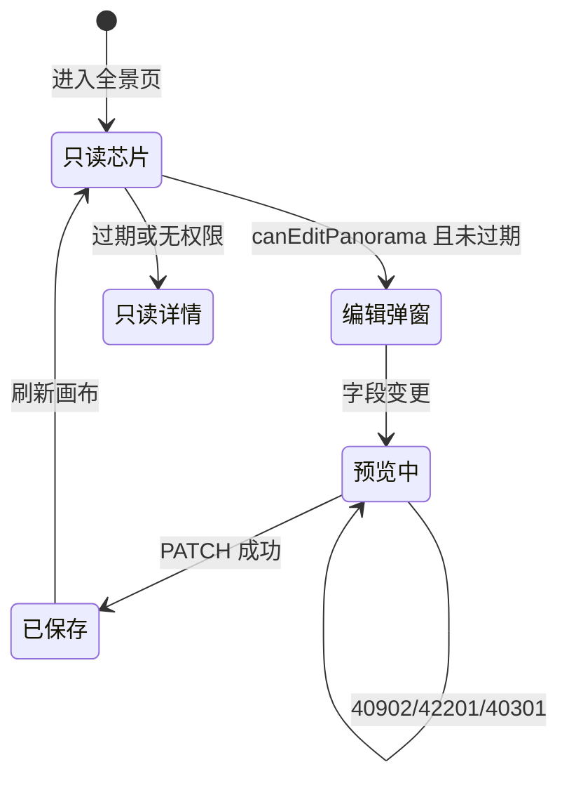
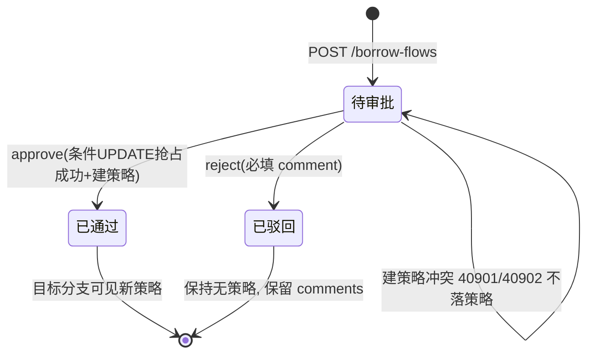
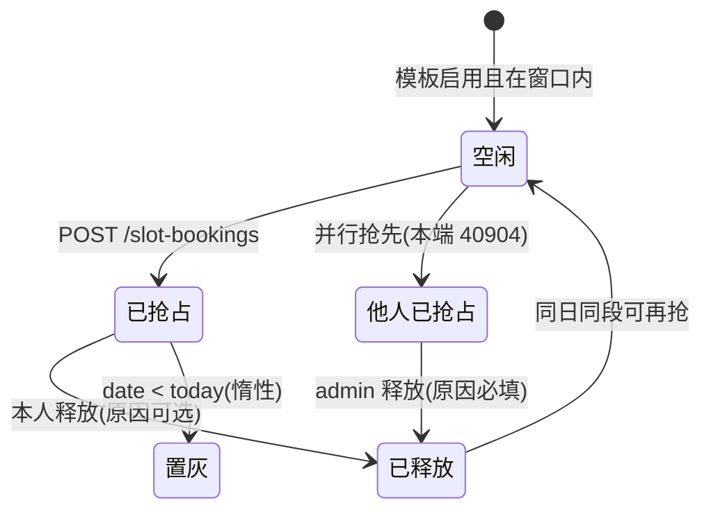
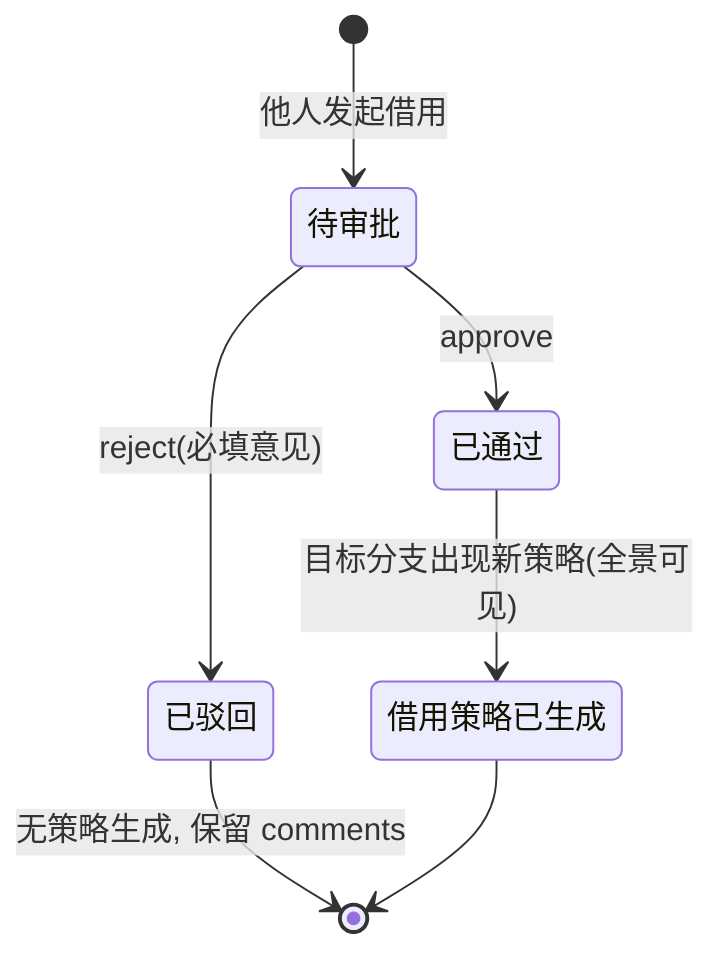

# 调度全景展示 业务场景 PRD（增量）

> **2026-10-24 状态注记**：本 PRD 成文于多页并存时代。文中「保留原列表页作深链兜底」「`/weekly-new` 之上增量建设」等表述所依赖的旧页面（`/weekly-new`、`/slot-booking`、`/borrow-flow` 独立页）已随 **2026-10-20 页面精简**（commit b37bab6）整体删除——四类场景入口已完全收敛于调度全景页与策略配置页；历史章节保留作决策追溯，现行页面结构以根 README 与 `AGENTS.md` 为准。

| 项 | 内容 |
|---|---|
| 日期 / 撰写 / 状态 | 2026-10-12 / 许清楚（产品经理） / 待评审 |
| 适用范围 | 在既有「版本策略全景(New)」（`/weekly-new/index`）之上增量建设，**不重写系统** |
| 技术栈 | 后端 Django 5 + DRF + SimpleJWT + SQLite；前端 Vue3 + Vite + TS + Element Plus + pure-admin-thin |
| 原始需求 | 调度全景展示设计，覆盖**修改 / 借用 / 抢占 / 借出**四类场景（触发入口、操作流程、状态流转、权限约束），并在同一套业务功能上给出 **5 种差异化布局** |

## 1. 产品目标与定位

| # | 目标 |
|---|---|
| G1 | 把分散在 4 个页面（策略配置 / 时段抢占月历 / 借用审批 / 全景只读）的调度动作，收敛为**一个全景页内的四类场景统一入口** |
| G2 | 打通两条独立调度体系（策略时间线 vs 时段抢占）"看得见但够不着"的断层，使抢占/借用结果在同一画布可见、可回溯 |
| G3 | 严格沿用既有后端接口与错误码，**P0 不新增后端接口**，权限前后端同口径双校验 |

**一句话定位**：调度全景 = 以「版本 × 时间」为轴的单一画布，让五个角色在同一处完成改时间、发借用、占时段、批借用四件事。

## 2. 用户故事

| 角色 | 故事一（作为…我希望…以便…） | 故事二（作为…我希望…以便…） |
|---|---|---|
| admin | 在全景页直接改任意版本的策略时间，不必在策略配置页反复切换版本 | 在全景页看到并释放任何人的时段抢占（填释放原因），快速腾挪冲突资源 |
| pm | 只改自己绑定版本的策略、其余版本只读，权责清晰、误操作可控 | 在全景页直接审批"借走我版本策略"的申请，通过后立刻生成借用策略，闭环不跳转 |
| builder | 只读纵览全部版本的构建与推送排布，安排构建机资源 | 对无权限的策略发起借用并选目标分支与时间，复用他人构建时段 |
| tester | 看到某时段已被谁抢占及用途，避开冒烟资源冲突 | 一键复制借用流内容发给审批人，便于线下催办 |
| integrator | 在同一画布看到推送（同步/正常）与抢占时段的叠加关系，安排集成窗口 | 抢占一个未来时段并关联版本分支，独占集成验证窗口 |

## 3. 业务场景拆解

> 状态字典（沿用既有中文文案）：pending→待审批、approved→已通过、rejected→已驳回、reserved→已抢占、released→已释放、normal→正常、sync→同步、draft→草稿、published→已发布。
> 错误码（严格沿用）：40100/40101/40301/40401/42201/40901/40902/40903/40904/42901。

### 场景 A：修改（改调度时间）

- **定义与目标**：内部维护人员调整策略的构建开始/推送时间、推送模式、模板、启停，使时间线重新推导；单次操作完成"改 + 预览 + 留痕 + 刷新"，冲突在保存前暴露。
- **入口迁移**：现分散在 `/strategy/index`（仅 pm）与系统管理策略 Tab（仅 admin）→ 合并进全景页芯片点击 → `StrategyEditDialog.vue`「修改」。

**操作流程**

| # | UI 动作 | 后端接口 |
|---|---|---|
| 1 | 点击未过期芯片，`resolveTaskClick` 判定 `kind:"edit"` | — |
| 2 | 编辑弹窗字段变更（防抖 300ms）→ 展示 timeline 预览；返回 conflict 则禁用保存 | `POST /api/strategies/preview`（编辑态**必须透传 id** → 服务端 `exclude_id`） |
| 3 | 保存（写字段级 `StrategyChangeLog`） | `PATCH /api/strategies/:id`（service 层 `transaction.atomic` + 校验） |
| 4 | 关闭弹窗刷新画布 | `invalidateStrategyCache()` + `GET /api/weekly` |

| 角色 | 能否修改 | 后端校验 | 前端守卫 |
|---|---|---|---|
| admin | 允许（全版本） | `views/strategies.py::_check_pm_bound` 放行 | `canEditPanorama(role, boundVersionId, versionId)` |
| pm | 受限（仅绑定版本） | `branch.version.pm_user != self` → 40301 | 同上 |
| builder/tester/integrator | 禁止 | 非 pm → 40301 | 同上返回 false |

| code | 文案 / 场景 | 前端表现 |
|---|---|---|
| 40901 | 阶段时间冲突 | 专用 `ElMessageBox.alert` 弹框 |
| 40902 | 同版本跨分支构建互斥 / 同名重名 | ElMessage 提示 |
| 42201 / 40301 / 40100 | 参数非法 / 越权改他人版本 / 未认证 | 提示 message / 「无权限执行该操作」/ 跳登录 |

**边界条件**：① 过期芯片（`isPastSlot(date,time,now)=true`）任何角色只读，`StrategyDetailDialog.vue` 无修改/借用入口；② 编辑态预览必须透传 `id`，否则服务端把自身算进互斥，原时间未变即误报 40902；③ `push_mode` 由 `weekly` 载荷显式返回，禁止以 `push_start_time` 是否存在反推推送模式。

---

### 场景 B：借用（borrow，借入方视角）

- **定义与目标**：无修改权限者复用他人版本策略的构建时段，借到**目标分支**并按新时间建策略；申请一次成型，通过后立刻生成借用策略并出现在全景页。
- **入口迁移**：发起已在全景页 `StrategyBorrowDialog.vue`；审批现散落在 `/borrow-flow/index` → 合并进全景页「待我审批」入口（保留原列表页作深链兜底 `?focus=<id>`）。

**操作流程**

| # | UI 动作 | 后端接口 |
|---|---|---|
| 1 | 无编辑权限用户点击芯片 → `kind:"borrow"` | — |
| 2 | 借用弹窗：上半只读详情，下半目标版本→目标分支（级联）+ 新构建时间（默认沿用原时间）+ 原因 | `GET /api/plan` |
| 3 | 提交 | `POST /api/borrow-flows` → `BorrowFlow(status=待审批)` |
| 4 | 审批：通过（事务内创建借用策略，命名 `{原策略名}({目标版本}借用)`、沿用原模板 + 普通推送）/ 驳回（必填意见） | `POST /api/borrow-flows/<id>/approve` \| `/reject` |
| 5 | 刷新全景页确认新策略出现 / 未出现 | `GET /api/weekly` |

| 角色 | 发起 | 审批 | 后端校验 | 前端守卫 |
|---|---|---|---|---|
| admin | 允许 | 允许（全量） | `_can_approve` | `canApproveBorrowFlow(user,{source_version_id})` |
| pm | 允许 | 受限（来源版本 = 绑定版本） | `flow.strategy.branch.version.pm_user_id == user.id` | 同上 |
| builder/tester/integrator | 允许 | 禁止（40301） | 同上 | 同上 |

| code | 文案 / 场景 | 前端表现 |
|---|---|---|
| 40903 | 该策略已有待审批的借用申请，请勿重复发起（并发双发起由 DB `uniq_pending_borrow_flow` → IntegrityError 兜底） | ElMessage 提示 |
| 42201 / 40401 | 目标版本不能是被借用策略所属版本 / 时间格式应为 HH:MM / 被借用策略不存在 | ElMessage 提示并刷新 |
| 40901/40902 / 40301 | 通过后建策略冲突 / 非来源版本 PM 审批 | 电子流保持**待审批** / 「无权限执行该操作」 |

**边界条件**：① **同版本互借被后端禁止**（目标分支版本 ≠ 来源版本，42201），PM 默认选绑定版本，若与来源相同须强制换版本；② 并发重复审批走 `filter(id=fid, status="pending").update(...)` 条件 UPDATE 抢占，0 行更新 → 后者落空 40903；③ **后端无撤销/撤回接口**，待审批只能 approve/reject，「主动撤销」列为 P2 新增接口需求，不得假定其存在。

---

### 场景 C：抢占（时段抢占 slot booking）

- **定义与目标**：用户按日占用管理员预配置的时段模板，先到先得，独占构建/集成窗口；在全景页同一时间轴看见"谁占了哪个时段"并就地抢占/释放。
- **入口迁移**：现散落在 `/slot-booking/index` 月历（全员）与 `/slot-config/index`（仅 admin，模板 + 记录）→ 合并进全景页日期/时段格抢占弹窗 + 「我的抢占」抽屉。

**操作流程**

| # | UI 动作 | 后端接口 |
|---|---|---|
| 1 | 渲染时段矩阵（`is_mine` 由服务端计算） | `GET /api/slot-calendar?month=YYYY-MM` |
| 2 | 点空闲芯片 → 抢占弹窗（版本→分支级联必选 + 用途 2~200 字），loading 防连点 | `GET /api/plan` |
| 3 | 提交 → 成功芯片就地翻转「我的」+ 300ms 闪烁 | `POST /api/slot-bookings` |
| 4 | 点「我的」芯片 → Popover → 释放（二次确认，本人原因可选）；「我的抢占」抽屉列未来抢占 | `POST /api/slot-bookings/<id>/release` \| `GET /api/slot-bookings/mine` |
| 5 | admin 释放他人（二次确认 + **必填释放原因**）/ admin 全量记录筛选 | 同上 release / `GET /api/slot-bookings` |

| 操作 | admin | pm/builder/tester/integrator | 后端校验 |
|---|---|---|---|
| 查看日历 / 模板 / 我的抢占 | 允许 | 允许 | 登录用户 |
| 抢占 | 允许 | 允许 | `services/slot_booking.create_booking` 校验链 |
| 释放自己的 | 允许 | 允许 | `user == booking.user` |
| 释放他人（必填原因） | 允许 | 禁止（40301） | 同上 |
| 模板 CRUD / 全量记录 | 允许 | 禁止（40301） | 管理员校验 |

| code | 文案 / 场景 | 前端表现 |
|---|---|---|
| 40904 | 该时段刚被 X 抢占（并发唯一约束兜底） | ElMessage.error + 自动重拉当月日历 |
| 42201 | 模板停用 / 过去日期 / 超 60 天窗口 / weekdays 不匹配 / 生效区间外 / branch 不属 version / purpose 非法 / admin 未填释放原因 | ElMessage 提示后端 message |
| 40301 / 40401 | 非 admin 释放他人或动模板 / 模板或抢占不存在 | 「无权限执行该操作」/ 提示并刷新 |

**边界条件**：① 可抢窗口 `today ≤ date ≤ today + SLOT_BOOKING_HORIZON_DAYS(60)`，过期为惰性置灰、**无 `expired` 枚举值**；② `weekdays` 为 isoweekday 1-7（1=周一…7=周日），空 = 每天，不支持跨午夜时段；③ 同一 `(date, template)` 唯一 reserved 由 DB 条件唯一约束兜底，已释放后同日同段可再抢；④ 明确不做批量抢占、抢占审批流、与策略互斥检测联动，删除有记录的模板 → 40902 应改用「停用」。

---

### 场景 D：借出（被借用方 / PM 审批视角）

- **定义与目标**：被借用策略所属版本的负责人（或 admin）处理他人借用申请，决定"借出"与否；审批者只看得到与自己版本相关的借用流，结果立刻反映到全景页。
- **入口迁移**：现 `/borrow-flow/index`（独立菜单 rank 14）→ 合并进全景页「待我审批」红点入口 + 审批抽屉（原列表页保留）。

**操作流程**

| # | UI 动作 | 后端接口 |
|---|---|---|
| 1 | 全景页「待我审批」红点显示待办数 | `GET /api/borrow-flows?status=pending`（服务端已按"与我相关"过滤） |
| 2 | 审批列表/抽屉展示策略 / 原时间 / 借用人 / 借用至 / 原因 | 同上 |
| 3 | 通过 / 驳回（必填意见） | `POST /api/borrow-flows/<id>/approve` \| `/reject` |
| 4 | 一键复制电子流文本（含审批详情链接）后刷新全景页 | `formatBorrowFlowText` + `navigator.clipboard`；`GET /api/weekly` |

**可见性口径**（`views/borrow_flow.py`）：admin 全量；pm = `Q(borrower=self)` ∪ `Q(strategy__branch__version__pm_user=self)`（自己发起的 + 待自己审批的）；builder/tester/integrator = 仅 `Q(borrower=self)`。

**权限约束**：与场景 B 审批列完全一致（`_can_approve` / `canApproveBorrowFlow`）。
**跨版本语义**：借出方 PM 固定为**来源版本**的 `pm_user`，借入方可为任意版本的人（目标分支版本 ≠ 来源版本）；可见性过滤保证他人版本的申请理由与审批意见对其他登录用户不可见。

| code | 文案 / 场景 | 前端表现 |
|---|---|---|
| 40301 | 非来源版本 PM 审批 | 「无权限执行该操作」 |
| 40903 | 重复处理 / 已终态再审批 | ElMessage 提示 |
| 42201 | 驳回未填意见、`status` 值域非法（仅 pending/approved/rejected） | ElMessage 提示 |
| 40901/40902 | 通过后建策略冲突 | 电子流保持待审批 |

**边界条件**：① `status` 参数仅接受 pending/approved/rejected，非法 → 42201；② 复制文案含他人输入（reason/审批意见），必须 VNode 文本渲染，**禁用 `dangerouslyUseHTMLString`**（存储型 XSS）；③ 审批通过后策略创建失败（冲突）时电子流**保持待审批**，不得标记已通过。

## 4. 统一交互契约（5 种布局共用）

| 层 | 约定 |
|---|---|
| 共同实体 | 版本 Version / 分支 Branch / 策略 Strategy（含 `push_mode`）/ 时段模板 SlotTemplate / 抢占 SlotBooking / 借用流 BorrowFlow — 全部取自既有接口，不新增领域模型 |
| 共同筛选 | 时间范围（周/月导航 + `?month=YYYY-MM` 深链）、版本（默认列表首项）、分支（多选，切换版本重置）、状态（待审批/已通过/已驳回/已抢占/已释放）、仅看我的（`is_mine` 服务端计算） |
| 共同动作集 | 修改（A）、借用（B）、抢占（C）、审批借出（D）、查看详情、复制文案、刷新；统一由 `resolveTaskClick` 分发并返回 `kind: edit/borrow/detail` |
| 共同权限守卫 | `canEditPanorama` / `canApproveBorrowFlow` / `isPastSlot`（`utils/business.ts` 纯函数，含单测）；前端隐藏 + 后端独立校验双保险 |

**权限矩阵（行 = 操作，列 = 角色）**

| 操作 | admin | pm | builder | tester | integrator |
|---|:--:|:--:|:--:|:--:|:--:|
| 查看全景画布 | 允许 | 允许 | 允许 | 允许 | 允许 |
| 修改策略时间 | 允许 | 受限（仅绑定版本） | 禁止 | 禁止 | 禁止 |
| 发起借用 | 允许 | 允许 | 允许 | 允许 | 允许 |
| 审批借出（通过/驳回） | 允许 | 受限（来源版本 = 绑定版本） | 禁止 | 禁止 | 禁止 |
| 抢占时段 | 允许 | 允许 | 允许 | 允许 | 允许 |
| 释放自己的抢占 | 允许 | 允许 | 允许 | 允许 | 允许 |
| 释放他人抢占 | 受限（必填原因） | 禁止 | 禁止 | 禁止 | 禁止 |
| 查看全量抢占记录 | 允许 | 禁止 | 禁止 | 禁止 | 禁止 |
| 时段模板 CRUD | 允许 | 禁止 | 禁止 | 禁止 | 禁止 |
| 查看借用流 | 全量 | 受限（自己发起 + 自己审批） | 受限（仅自己发起） | 受限（仅自己发起） | 受限（仅自己发起） |

**5 种差异化布局（同一契约，不同呈现）**

| # | 布局 | 主轴 | 适配与价值 |
|---|---|---|---|
| L1 | 周 × 时刻策略矩阵（现状增强） | 周一~周日 × 精确时间点 | 所有角色；排布纵览 + 芯片就地改/借用 |
| L2 | 月历时段抢占图 | 月 × 42 格 × 时段模板 | builder/integrator；资源先到先得 |
| L3 | 版本泳道甘特 | 行 = 分支（按版本分组）× 时间轴 | pm；跨分支互斥与冲突肉眼可读 |
| L4 | 待办聚合工作台 | 卡片流：待审批借用 / 我的抢占 / 待处理冲突 | pm/admin；以"要做什么"驱动 |
| L5 | 时间轴流水（日志态） | 单日 24h 纵向流水 + 变更留痕 | tester/admin；复盘"谁在何时改了什么" |

> 五布局共享同一套筛选、动作集与权限矩阵，切换布局仅换渲染层、不改数据与接口。L1/L2 可用既有接口直接实现；L3/L5 纯前端聚合；L4 若要求服务端统一计数属**新增**接口（见 P2-R3）。

## 5. 需求池

### P0（必须：同一页面内完成四个场景）

| id | 描述 | 验收标准 | 依赖 |
|---|---|---|---|
| P0-R1 | 芯片点击按权限分发 `edit/borrow/detail`，过期芯片强制只读 | admin 全版本可改；pm27a 切 26B 只读；builder 无点击光标 | 既有 `resolveTaskClick` |
| P0-R2 | 编辑弹窗内嵌预览 + 冲突禁用保存，保存走 PATCH 并刷新画布 | 冲突报 40901 专用弹框；保存后画布时间立即更新 | `POST /strategies/preview` 透传 id |
| P0-R3 | 全景页内发起借用（目标版本 ≠ 来源版本 + 时间 + 原因） | 生成待审批；重复 40903；同版本目标前端拦截 + 后端 42201 | `POST /borrow-flows` |
| P0-R4 | 全景页内审批借出（通过/驳回，驳回必填意见） | 通过后目标分支出现借用策略；非来源 PM 按钮不渲染且后端 40301 | `_can_approve` |
| P0-R5 | 全景页内嵌时段矩阵：抢占 / 我的释放 / admin 释放（必填原因） | 40904 提示 + 自动重拉；过期格置灰不可交互 | `/slot-calendar`、`/slot-bookings` |
| P0-R6 | 权限矩阵前后端同口径 | `canEditPanorama`/`canApproveBorrowFlow` 单测覆盖 5 角色 × 场景 | `utils/business.ts` |

### P1（体验与批量能力）

| id | 描述 | 验收标准 | 依赖 |
|---|---|---|---|
| P1-R1 | 布局切换器（L1~L5）+ URL 深链同步，刷新保持 | URL 带 `?layout=`，刷新恢复且数据一致 | P0 |
| P1-R2 | 统一筛选栏（时间/版本/分支/状态/仅看我的）五布局共用 | 筛选后统计、芯片、空态联动；无匹配显示空态 | P0 |
| P1-R3 | 抢占与策略时间线同画布叠加显示 | 冲突时段视觉标记（仅提示，不改后端互斥逻辑） | P0-R5 |
| P1-R4 | 批量释放"我的抢占"、批量驳回借用流（循环调用既有单条接口） | 逐条成功/失败汇总提示，失败项保留 | P0 |
| P1-R5 | 键盘可达与无障碍（芯片 `<button>` + aria-label、状态不只靠颜色） | 焦点环可见；对比度 WCAG AA | P0 |

### P2（新增接口需求 / 远期）

| id | 描述 | 验收标准 | 依赖 |
|---|---|---|---|
| P2-R1 | **【新增接口】** 借用撤销 `POST /api/borrow-flows/<id>/cancel` | 仅借入方本人且状态 = 待审批可撤；撤后释放 `uniq_pending_borrow_flow` | 当前**不存在**，需后端新增 |
| P2-R2 | **【新增接口】** 抢占改期 / 拖拽 `PATCH /api/slot-bookings/<id>` | 仅本人或 admin；改期后同日同段唯一约束仍生效 | 现状为"抢占后不可修改，需先释放" |
| P2-R3 | **【新增接口】** 待办聚合 `GET /api/panorama/todos` | 一次返回待审批数 / 我的抢占数 / 冲突数，供 L4 红点 | L4 布局 |
| P2-R4 | 同版本内分支互借放开 | 需改 `borrow_flow_create_view` 同版本校验 + 重定义冲突语义 | 待用户决策（Q4） |
| P2-R5 | 策略 ↔ 抢占双向联动互斥 | 需新建关联关系（当前两体系无外键） | 待用户决策（Q5） |

## 6. 待确认问题

| # | 问题 | 备选 / 建议 |
|---|---|---|
| Q1 | 全景页是否对 builder/tester/integrator 保留只读但仍可发起借用？还是完全只读（仅 pm/admin 可操作）？ | 建议保留"只读 + 可借用"（对齐现状） |
| Q2 | 抢占在全景页**直接做**还是**跳转**到 `/slot-booking`？ | 建议直接做（P0-R5），保留原月历页不删 |
| Q3 | 布局切换器放哪？5 种布局是用户自选还是按角色固定？ | 建议全员可切换 + localStorage 记住上次选择 |
| Q4 | 借用是否放开**同版本内分支互借**？当前后端明确禁止（42201） | 放开需改后端校验 + 重定义冲突语义，建议先不放开 |
| Q5 | 是否需要策略时间线与时段抢占的**双向互斥联动**？当前两者是独立资源池 | 需要则须新建关联模型，建议列入 P2 |
| Q6 | 是否需要「我的待办」聚合入口（L4）？红点计数走前端聚合还是新增接口？ | 前端聚合可先落地；服务端统一计数见 P2-R3 |
| Q7 | 借用审批是否支持转交 / 代批（PM 不在时指定代理人）？ | admin 天然可全量审批，是否还要"指定代理人"待定 |
| Q8 | 过期策略是否允许"改明天及以后"、仅锁定历史格子？ | 建议按格子判定（`isPastSlot`），历史格只读、未来格可改 |
